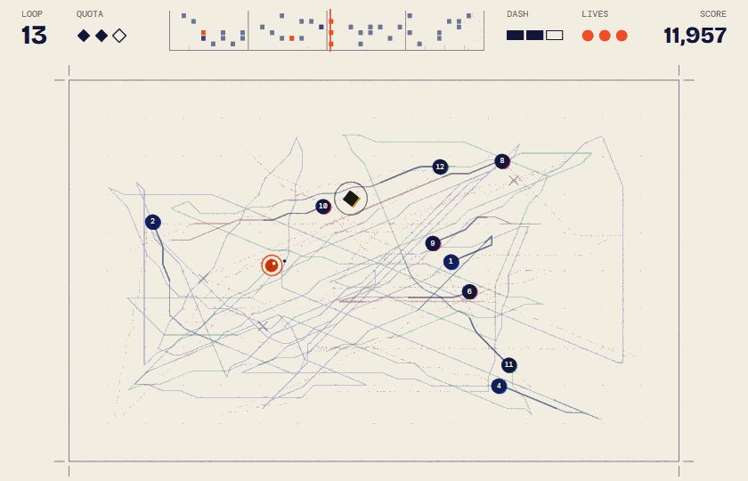
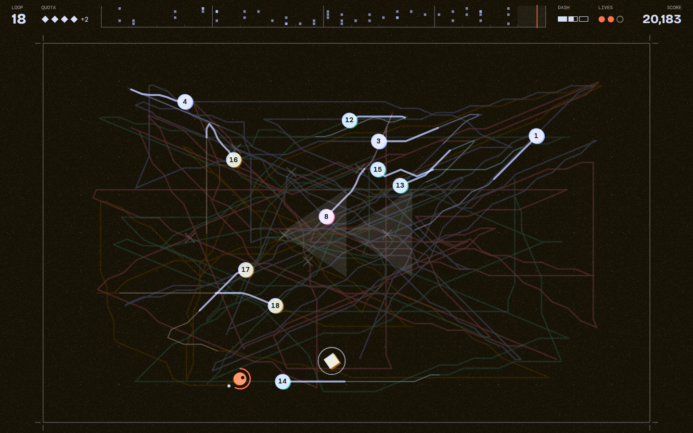
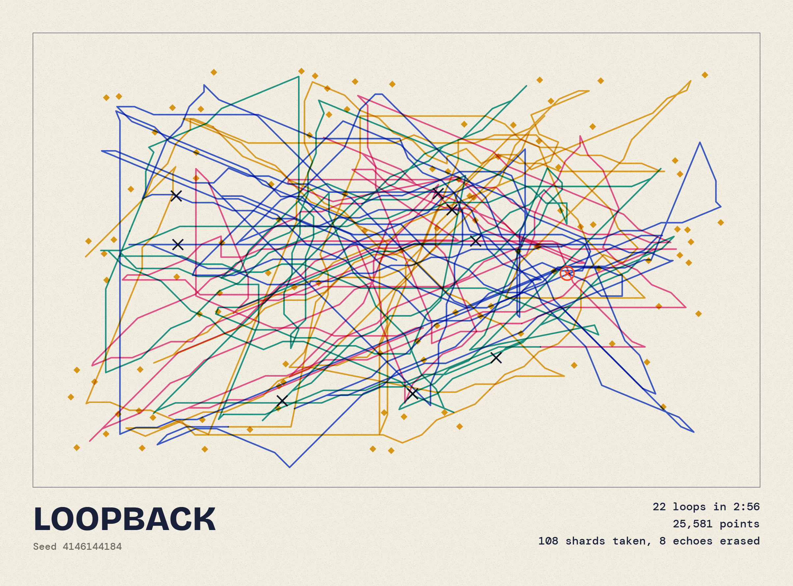
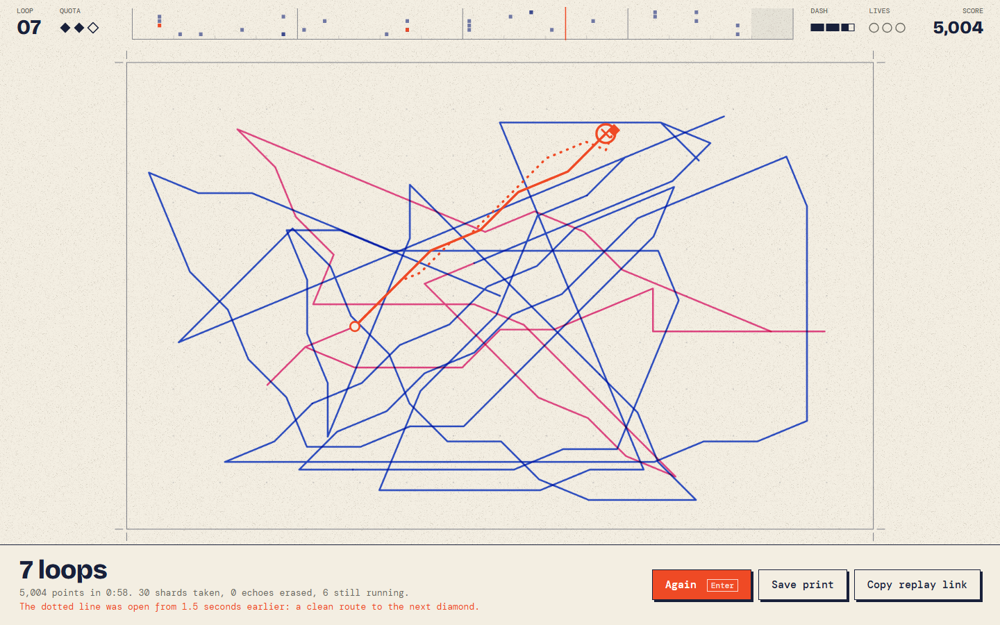

<div align="center">

# Loopback

**A game where the only enemy is you.**

Every eight seconds, time loops, and everything you did comes back.



</div>

## What this is

Take the diamond. When eight seconds are up, time snaps back, and the you from that loop runs its route again while you play the next one. Touch it and you lose a life. Next loop there are two of them, then three.

So you are writing your own bullet hell as you play. The shortcut you took in loop 3 is still out there in loop 30, and good play is partly dodging and partly thinking about what you are leaving behind.

- **Graze to charge, dash to erase.** Brushing past an echo fills your dash. Dashing through an echo destroys it.
- **The soundtrack is your run.** Every diamond plays a note, and from then on that echo plays it again at the same point in the bar, like a loop pedal. The strip across the top of the screen is that tune, written as you play. Erase an echo and its notes stop.
- **Every run ends as a print.** Each route is overprinted in riso-style inks, and you can save the result as a poster.

| | |
|:---:|:---:|
|  |  |

## The headline: every death comes with a second opinion

Everything that can hit you is a recording of your own past, so the future is fully known, and "could I have survived that?" has an exact answer. When you die, a solver goes back 1.5 seconds, using only what was on screen at the time, and draws the route you could have taken next to the one you did take.



A route only counts if it holds up, so each one is played through the real simulation as a check. This is measured by `npm run evaluate`, over 200 seeded runs per bot:

| | Reflex bot | Planner bot |
|---|:---:|:---:|
| What it knows | Reacts 0.25 s late, and guesses where echoes are going | Every echo's whole future |
| Median loops survived | **6** | **42** |
| 10th to 90th percentile | 3 to 8 | 26 to 60 (the cap) |
| Ended by a hit | 199 | 6 |
| Ended by missed quotas | 1 | 169 |
| Reached the 60 loop cap | 0 | 25 |
| **Deaths where a way out existed** | **198 of 199** | **6 of 6** |
| Replays that reproduced the run exactly | 200 of 200 | 200 of 200 |
| Median replay link | 322 characters | 4,406 characters |

The reflex bot is a rough stand-in for a person, used to compare difficulty between versions. It isn't a claim about how long you will last.

## How it works

One idea does nearly all the work: **a run is a pure function of its seed and its inputs.** The simulation in [`src/sim`](src/sim) never touches the DOM, the clock or `Math.random`.

- **Echoes** are the player's own recorded positions, played back.
- **Being hit rewinds time by re-simulating.** There are no snapshots to manage: the game restores the start of the loop and runs this loop's inputs again, up to two seconds ago. The past is just the same inputs run again.
- **A replay fits in a URL**, with no server. The inputs are run-length encoded, and opening a link re-simulates the run to show its result before you press play.
- **The bots use the same input byte as a person**, so they can't cheat, and a bot's run is a normal replay.
- **The solver** in [`src/bot/planner.ts`](src/bot/planner.ts) is A* through space and time. It checks every tick exactly as the simulation will, and plans in about 10 ms at worst, so it also plays the game live behind the title screen.

### Why replays work across browsers

The JavaScript spec lets each engine round `Math.sin` and `Math.cos` differently, and one different bit would derail a replay on another browser. So the simulation doesn't call them: movement headings come from a table built with plain arithmetic, which the spec does pin down exactly. A browser test records runs in Node, replays them in V8, SpiderMonkey and JavaScriptCore, and requires the final state of each one to match to the last bit.

### No engine, no assets

Everything is drawn on one Canvas 2D context, with no WebGL. Every sound is synthesized with Web Audio, so there are no audio files, and an offline render test checks that a deep run's music neither clips nor falls silent. The only runtime dependencies are two fonts. The game's JavaScript is 45 kB, or 16.6 kB gzipped.

## Controls

| | Move | Dash |
|---|---|---|
| **Keyboard** | `WASD` or arrow keys | `Space` or `Shift` |
| **Mouse** | Move the pointer: you head toward it | Click |
| **Touch** | Drag anywhere | Tap, or use a second finger |

`Esc` pauses, `R` starts over, `M` turns the sound on or off. On a tall phone screen, the whole arena turns on its side.

## Running it

Requires Node 24 or later.

```bash
npm install
npm run dev
```

| Command | What it does |
|---|---|
| `npm test` | Unit tests for the simulation, replays and solver |
| `npm run test:e2e` | Browser tests, including determinism on three engines |
| `npm run evaluate` | Plays hundreds of runs with no human and reports the numbers above |
| `npm run capture` | Records the screenshots and GIF in this README from the real game |

To watch a bot play a normal run, add `?bot=planner` or `?bot=reflex` to the URL, and optionally `&speed=8`.

## Code layout

| Path | Purpose |
|---|---|
| `src/sim/` | The game itself, deterministic and with no DOM access, plus the replay format |
| `src/bot/` | The space-time solver, the two bots, and the way-out search |
| `src/audio/` | The music theory, the synthesizer, and the conductor that turns a run into a tune |
| `src/render/` | The Canvas 2D renderer, effects, and the print |
| `src/ui/` | Keyboard, mouse and touch input, and saved scores |
| `src/main.ts` | Wires it all to the page: the clock, the screens and the hints |

Changing anything in `src/sim` changes how old runs play out, so bump `FORMAT` in [`replay.ts`](src/sim/replay.ts) when you do. Old links then say they are out of date instead of playing wrongly.

## License

[MIT](LICENSE)
